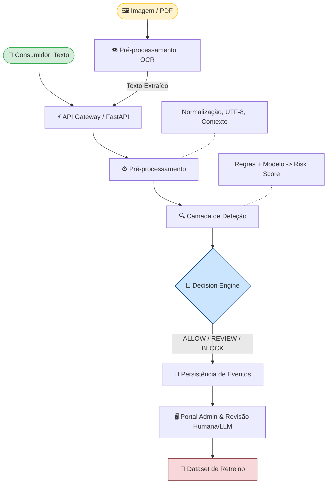

# FIAP - Faculdade de Informática e Administração Paulista

<p align="center">
</a>
</p>

<br>

# 🎓 Graduação ON em Inteligência Artificial  
## 📚  CHALLENGE INTELLIWAY

## 👨‍🎓 Integrantes: 
- <a href="https://www.linkedin.com/in/paulo-pereira-de-souza-junior-mba-msc-0b497825/">Paulo Pereira de Souza Junior</a>

## 👨‍🎓 Apresentacao: 
- <a href="https://youtu.be/6IrO9j_jJ9E">Video Apresentação - YOUTUBE</a>

## 👨‍🎓 Git Hub: 
- <a href="https://github.com/ppsj1983/GS_2026_01">GS 2026 1º Semestre</a>

## 👩🏻‍💻 CO objetivo deste Challenge é desenvolver um serviço de segurança, independente e consumido por API, capaz de detectar tentativas de prompt injection em Português do Brasil e devolver uma decisão clara para o sistema que o consulta

## 👩🏻‍💻 Linha de Pesquisa: Segurança de IA
 
## 👩🏻‍💻 Sprint 1, estruturação da base do projeto, focando na compreensão do problema e das ameaças, no planejamento do dataset em PT-BR, na definição da arquitetura do serviço e na escolha de quais User Stories

## 👩🏻‍💻 Visão do projeto: Serviço Inteligente de Detecção e Prevenção de Prompt Injection
Serviço independente de segurança de IA destinado à identificação de tentativas de *prompt injection*, com foco prioritário em conteúdos escritos em Português do Brasil.
A solução será posicionada como uma camada de proteção entre conteúdos potencialmente não confiáveis e aplicações baseadas em IA.
O objetivo é permitir que sistemas consumidores submetam textos ou conteúdos convertidos em texto para análise e recebam uma decisão estruturada:

- 📌ALLOW: conteúdo considerado suficientemente seguro;
- 📌REVIEW: conteúdo ambíguo ou de risco intermediário;
- 📌BLOCK: forte indicação de tentativa de Prompt Injection.

---

## 🎯 Objetivo

Este trabalho tem como objetivo:

Desenvolver um *prompt injection PT-BR*, independente e consumível por uma API, capaz de analisar conteúdo potencialmente não confiável e retornar uma decisão de segurança baseada no risco identificado.
A arquitetura será desacoplada do sistema consumidor, portanto não dependerá do código, banco ou infraestrutura do EvaGPT.

## 🎯 Objetivo Específicos

O projeto terá os seguintes objetivos:
- 📌construir um dataset especializado em ataques e conteúdos legítimos em PT-BR;
- 📌treinar e comparar um classificador profundo;
- 📌produzir um risk_score entre 0 e 1;
- 📌transformar o score em ALLOW / REVIEW / BLOCK;
- 📌disponibilizar a classificação por API;
- 📌fornecer um portal administrativo;
- 📌suportar imagem e PDF digitalizado por OCR;
- 📌avaliar precision, recall, F1-score, AUC e falsos positivos;
---

## 🧠Classificação do tipo de ameaça

Todo conteúdo analisado é tratado como dado potencialmente não confiável. Entre os ativos a proteger estão prompt base e políticas do agente, dados privados recuperados por RAG, contexto da conversa, informações de sistemas conectados, permissões de ferramentas e integridade das decisões executadas pelo agente. 

*Taxonomia inicial*

A taxonomia sugerida no documento de User Stories inclui, entre outras categorias, conforme imagem a seguir:

<p align="center">

</p>

## 🧠 Escolha de User Story

Nesta etapa, selecionamos todas as *User Stories do P0 como núcleo do projeto*.
Épico A: Motor
P0
- 📌 US-MOT-01: Dataset PT-BR
- 📌 US-MOT-02: Treinamento do modelo
- 📌 US-MOT-03: Avaliação e definição de limiares
- 📌 US-MOT-04: Imagem/PDF + OCR
- 📌 US-API-01: análise;
- 📌 US-API-02: validação e erros;
- 📌 US-ADM-02: dashboard;
- 📌 US-ADM-03: histórico;
- 📌 US-ADM-04: avaliação LLM + revisão humana;
- 📌 US-ADM-05: exportação de dados rotulados.

## 🧠 Estratégia do dataset PT-BR

Nesta etapa vamos combinar datasets públicos traduzidos, exemplos próprios e exemplos sintéticos revisados. Também criação de estrutura para treino, validação e teste, sem repetição de exemplos.

- 📌 Camada 1: dados públicos: Como ponto inicial, utilizaremos dataset deepset/prompt-injections como possível fonte pública. 

- 📌 Camada 2: exemplos originalmente escritos em PT-BR: Tambem trabalharemos na criar de exemplos específicos do contexto brasileiro envolvendo:
```bash
    atendimento
    suporte técnico
    documentos
    procedimentos
    e-mails empresariais
    RAG
    assistentes virtuais
    automações
```
- 📌 Camada 3: ataques sintéticos: Utilizaremos IA Generativa poderá auxiliar na preparação de diferentes variações.

### 📊 Proposta conceitual de Estrutura de Detecção (prompt injections)

O desenvolvimento do motor de detecção será estruturado em três níveis.

- 📌 Nível 1: Baseline Baseada em Regras (Regex)

• Abordagem: Implementação de um fluxo de normalização textual para o português do Brasil (PT-BR), seguido da aplicação de expressões regulares (Regex) para a identificação de padrões e termos suspeitos.
• Objetivo: Funcionar como o primeiro benchmark do projeto. Embora não represente a solução final devido à sua rigidez, estabelecerá a capacidade mínima de deteção do sistema.

- 📌 Nível 2: Baseline Estatística (TF-IDF)

• Abordagem: Criação de um pipeline clássico de Processamento de Linguagem Natural (PLN): extração de características via TF-IDF, seguida pelo treino de um classificador supervisionado tradicional para calcular a probabilidade de ataque.
• Objetivo: Servir como um elo comparativo intermédio, permitindo quantificar com precisão o valor acrescentado e a evolução do modelo de aprendizagem profunda (Deep Learning) face aos métodos estatísticos tradicionais.

- 📌 Nível 3: Modelo de Aprendizagem Profunda (Deep Learning)

• Abordagem: Utilização do modelo pré-treinado de última geração protectai/deberta-v3-base-prompt-injection-v2. Numa fase posterior, o modelo será adaptado especificamente para o contexto de PT-BR através de fine-tuning, recorrendo a técnicas de eficiência paramétrica como LoRA (Low-Rank Adaptation).
• Objetivo: Constituir o estado da arte do motor, maximizando a precisão na deteção de injeções de prompt (prompt injections).


### 📊 Matriz de Comparação dos Modelos

A tabela abaixo detalha a configuração técnica e o propósito de cada iteração dentro do fluxo experimental:

| Fase | Abordagem Técnica | Inputs / Pré-processamento | Papel no Projeto |
| :--- | :--- | :--- | :--- |
| **1. Regex** | Expressões Regulares estruturadas | Normalização textual básica (PT-BR) | **Baseline 1:** Estabelece o limiar mínimo de segurança e a taxa base de deteção. |
| **2. TF-IDF** | Matriz de frequência + Classificador Supervisionado | Tokenização tradicional de PLN | **Baseline 2:** Quantifica o ganho obtido por métodos estatísticos clássicos. |
| **3. DeBERTa v2** | `protectai/deberta-v3-base-prompt-injection-v2` | Tokenizador nativo do modelo | **Modelo Base:** Demonstra o salto de desempenho através de *Deep Learning* (*zero-shot*). |
| **4. DeBERTa + LoRA** | Fine-tuning com Low-Rank Adaptation (LoRA) | Dataset especializado em PT-BR | **Modelo Final:** Estado da arte do motor, otimizado para as nuances do português. |

## 🏗️ Arquitetura do Sistema e Fluxo de Dados

O diagrama abaixo apresenta o fluxo de dados, considerando a entrada dos dados (texto ou documentos digitalizados) até a geração do dataset com a classificação e componentes analisados.



### 🔹 Componentes Principais

*   **Ingestão Dupla:** Suporta strings de texto direto ou arquivos de imagem/PDF convertidos automaticamente via OCR.
*   **Pipeline de Borda:** O texto é normalizado e avaliado de forma híbrida (regras estáticas + IA) para gerar o `risk_score`.
*   **Políticas de Ação:** O *Decision Engine* bloqueia, aprova ou envia a requisição para análise com base no score.
*   **Loop de Feedback:** Os eventos geram relatórios para revisão assíncrona, criando a base para o retreino periódico dos modelos.


## 🛠️ Especificação de Arquitetura (Tech Stack)

A escolha dos componentes técnicos prioriza a integração nativa com o ecossistema de Inteligência Artificial e a adoção de tecnologias estritamente *open source*.

### 🧠 Backend & Machine Learning (Python)
*   **API:** `FastAPI`.
*   **ML Clássico & Baselines:** `scikit-learn`.
*   **Deep Learning & NLP:** `PyTorch` + `Hugging Face Transformers`.
*   **Otimização:** `PEFT` / `LoRA` (*fine-tuning*).

### 👁️ Camada OCR (Open Source)
*   **Motor Principal:** `PaddleOCR`.

### 💾 Persistência de Dados
*   **Banco de Dados:** `Banco de Dados Oracle FIAP`
*   **Esquema de Eventos (Histórico do Portal):**
    Cada requisição persistirá os seguintes metadados para auditoria e retreino:
    `trace_id` | `timestamp` | `texto_analisado` | `source_type` | `decisao` | `score` | `modelo` | `latencia` | `avaliacao_llm` | `revisao_humana` | `rotulo_final`

### 🖥️ Front-end
*   **Interface (Portal Admin):** `React` (Seguindo os critérios de aceite da *Definition of Done* do projeto).

## 🖥️ API de Análise de Conteúdo

Esta API é responsável por analisar textos recebidos através de diferentes fontes e determinar se representam algum tipo de risco ou ataque.

## Contrato Inicial (v1)

### Endpoint

* **Rota:** `/v1/analyze`
* **Método:** `POST`
* **Content-Type:** `application/json`

### Requisição (Request)

**Payload:**

```json
{
  "text": "conteúdo a ser analisado",
  "source_type": "EMAIL",
  "language": "pt-BR",
  "metadata": {
    "conversation_id": "conv-123"
  }
}
```

**Campos:**
* `text` (String): Conteúdo textual que será submetido à análise.
* `source_type` (String): Origem do conteúdo (ex: `EMAIL`).
* `language` (String): Idioma do texto (ex: `pt-BR`).
* `metadata` (Object): Objeto opcional contendo dados de contexto, como `conversation_id`.

---

### Resposta (Response)

**Payload:**

```json
{
  "decision": "BLOCK",
  "risk_score": 0.94,
  "attack_types": [
    "PI_DIRECT_OVERRIDE"
  ],
  "reason_codes": [
    "HIGH_RISK_SCORE"
  ],
  "trace_id": "trace-abc"
}
```

**Campos:**
* `decision` (String): Decisão final da análise (ex: `ALLOW`, `BLOCK`).
* `risk_score` (Float): Pontuação de risco calculada, variando de 0.0 a 1.0.
* `attack_types` (Array de Strings): *Opcional*. Tipos de ataque identificados.
* `reason_codes` (Array de Strings): *Opcional*. Códigos de motivo que justificam a decisão.
* `trace_id` (String): Identificador único da transação para fins de rastreabilidade.

## 🖥️ Modelo simplificado (motor de classificação e decisão)

O modelo abaixo apresenta o fluxo simplificado do modelo de análise

```bash
    A [Entrada de Conteúdo] --> B [Normalização/OCR]
    B --> C [Detecção]
    C --> D [Risk Score]
    D --> E {ALLOW / REVIEW / BLOCK}
    E --> F [Auditoria]
    F --> G [Avaliação]
    G --> H [Feedback]
    H --> I [Retreino]
    I --> A
```
## 🖥️ Métricas de Avaliação e Indicadores Operacionais

O sucesso e o comportamento do modelo são monitorados através de métricas de qualidade de dados (ciência de dados) e indicadores de performance em produção (infraestrutura/operação).

### 📈 Métricas de Avaliação Principal (Requisitos P0)

Estes indicadores medem a assertividade do modelo em prever riscos e ataques:

* **Precision (Precisão):** Proporção de alertas verdadeiros entre todas as classificações positivas.
* **Recall (Revocação):** Capacidade do modelo de encontrar todos os casos reais de risco.
* **F1-Score:** Média harmónica entre Precision e Recall para equilíbrio do modelo.
* **AUC (Area Under the ROC Curve):** Medida de capacidade de distinção global entre classes.
* **Matriz de Confusão:** Tabela de mapeamento para identificação de Verdadeiros/Falsos Positivos e Negativos.
* **FPR em Hard Negatives:** Taxa de Falsos Positivos calculada especificamente sobre amostras críticas/ambíguas.

---

### ⚙️ Indicadores Operacionais (Negócio e Infraestrutura)

Métricas utilizadas para monitorar a eficiência da API e o comportamento do tráfego em tempo real:

#### Performance & Latência
* **Latência Média:** Tempo médio total gasto no processamento de cada requisição.
* **P50 (Percentil 50):** Tempo limite em que 50% das requisições são respondidas (mediana).
* **P95 (Percentil 95):** Tempo limite em que 95% das requisições são respondidas (experiência dos utilizadores mais lentos).

#### Distribuição & Volumetria
* **Distribuição de Decisões:** Proporção e volume de ações aplicadas (`ALLOW` / `REVIEW` / `BLOCK`).
* **Métricas por `source_type`:** Divisão do volume e comportamento das análises agrupadas por origem (ex: `EMAIL`).
* **Métricas por Versão do Modelo:** Comparativo de performance e volumetria entre as diferentes versões do modelo em produção.
